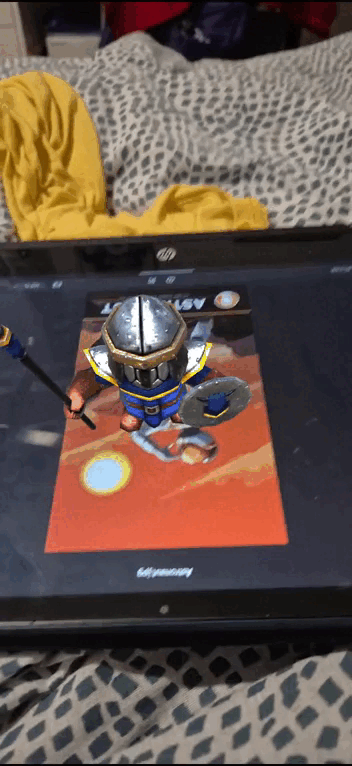

# Práctica de Unity: Realidad aumentada con Vuforia

En esta práctica se crea una aplicación de realidad aumentada para Android con **Vuforia Engine**. La aplicación reconoce **dos imágenes objetivo** con la cámara y muestra sobre cada una un **objeto 3D diferente**, que aparece mientras la imagen está a la vista y desaparece al perderla.

📦 APK: [practicaRA.apk](APK/practicaRA.apk)

---

## Configuración del proyecto

- **Paquete:** *Vuforia Engine AR*, importado en un proyecto 3D nuevo. Unity avisa de que el paquete no tiene firma; es un aviso normal en los paquetes que no vienen del registro de Unity.
- **Licencia:** se genera una *Basic License* en el **License Manager** del portal de desarrolladores de Vuforia. La clave se pega en el campo **App License Key**, al que se llega desde la AR Camera con *Vuforia Behaviour → Open Vuforia Engine configuration*.
- **Cámara:** se elimina la *Main Camera* y se añade la **AR Camera** (*GameObject → Vuforia Engine → AR Camera*), para que no haya dos cámaras ni dos *Audio Listener*.
- **Plataforma Android:** IL2CPP, ARM64 y un *Minimum API Level* compatible con Vuforia.

---

## Base de datos de objetivos

En el **Target Manager** de Vuforia se crea una base de datos de tipo *Device* y se añaden las dos imágenes como objetivos de tipo *Image*, indicando su ancho real.

Para que se reconozcan bien, las imágenes tienen mucho detalle, buen contraste y muchas esquinas, sin patrones repetidos ni zonas lisas. Las dos obtienen **3 estrellas o más** en el Target Manager. Las imágenes se suben en **JPG (RGB de 24 bits)**: un PNG con canal alfa se rechaza con el error `Wrong_Color_Model`.

La base de datos se descarga para *Unity Editor* y se importa en el proyecto como paquete.

---

## Escena

Se añaden dos **Image Target** (*GameObject → Vuforia Engine → Image Target*). En el componente **Image Target Behaviour** de cada uno se elige el tipo *From Database*, la base de datos importada y una de las dos imágenes.

Cada objetivo tiene como **hijo** un objeto 3D diferente, colocado y escalado sobre la imagen. Vuforia solo muestra los hijos de un Image Target mientras la cámara reconoce esa imagen, de modo que cada imagen hace aparecer su propio objeto. El componente *Default Observer Event Handler* de cada objetivo se encarga de mostrarlos y ocultarlos con los eventos *On Target Found* y *On Target Lost*.

Los modelos de la Asset Store se veían de color rosa, porque sus materiales usan el shader estándar y el proyecto usa URP. Se arreglan con *Window → Rendering → Render Pipeline Converter*, o asignando a los materiales el shader *Universal Render Pipeline/Lit*.

---

## Pruebas y APK

En el editor la aplicación se prueba con la **webcam** del ordenador: al darle a *Play*, se muestra a la cámara una de las imágenes en la pantalla del móvil o impresa en papel, y aparece su modelo 3D encima.

La APK funciona en cualquier móvil Android compatible con Vuforia, usando su cámara trasera. Para probarla hay que enfocar con el móvil las dos imágenes objetivo, en pantalla o impresas.
